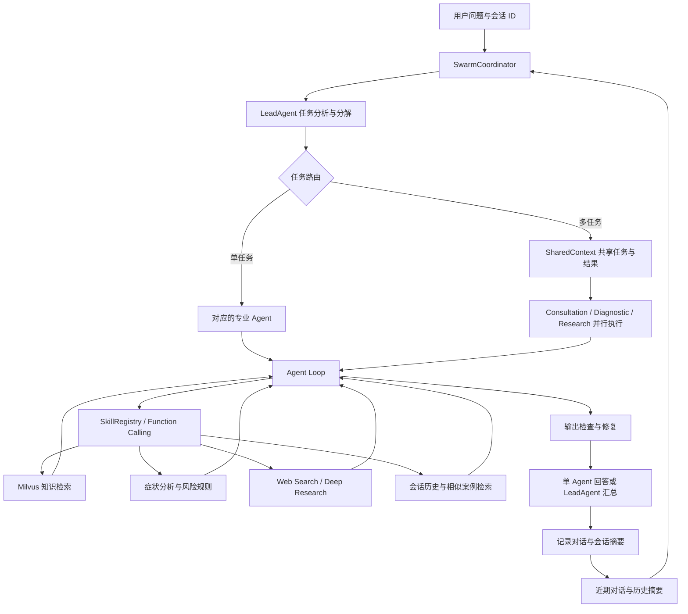

# Medical Assistant Agent

面向健康咨询、症状信息分析和医学资料检索的多智能体助手。项目将 **LLM 工具调用、任务分解、并行协作、RAG 检索和分层记忆**整合为一条问答流程，并提供基于 Qwen3-VL 的医学多模态强化学习训练与评估模块。

**技术栈：** Python · asyncio · OpenAI-compatible API · Milvus Lite · BGE Embeddings · Mem0 · Redis · PyTorch · veRL · vLLM

[系统架构](#系统架构) · [核心实现](#核心实现) · [快速开始](#快速开始) · [训练与评估](#训练与评估) · [代码导航](#代码导航)

## 项目概述

医疗信息问答经常需要同时处理多个问题：理解用户描述、补充历史上下文、检索知识、识别风险提示，并将不同来源的信息组织为回答。本项目采用三类专业 Agent 共享 Skills 的设计，由 LeadAgent 分解任务，SwarmCoordinator 选择单 Agent 或多 Agent 执行路径。

| 场景 | 处理方式 |
| --- | --- |
| 健康咨询 | 检索知识库，组织生活方式相关信息 |
| 症状信息分析 | 结合规则与知识检索，提取症状模式、风险提示和相关编码 |
| 医学资料研究 | 联合检索本地知识与网络资料，综合关键发现、来源及证据描述 |
| 多轮追问 | 按会话读取近期对话，并检索相关历史会话摘要 |
| 多任务问题 | 拆分子任务，由专业 Agent 并行执行后汇总 |

当前应用入口为命令行交互，也可通过 Python 异步接口调用。训练评估模块独立运行，Agent 通过 `config.py` 中的 OpenAI-compatible API 接入模型。

## 系统架构



| 角色 | 职责 | 代码入口 |
| --- | --- | --- |
| `LeadAgent` | 分析问题、拆分子任务、汇总多 Agent 结果 | [lead_agent.py](medix-agent-swarm/swarm/lead_agent.py) |
| `SwarmCoordinator` | 选择执行路径、启动并行任务、处理超时、保存摘要 | [swarm_coordinator.py](medix-agent-swarm/swarm/swarm_coordinator.py) |
| `ConsultationAgent` | 健康咨询与生活方式信息整理 | [consultation_agent.py](medix-agent-swarm/agents/consultation_agent.py) |
| `DiagnosticAgent` | 症状信息分析、风险提示与疾病编码检索 | [diagnostic_agent.py](medix-agent-swarm/agents/diagnostic_agent.py) |
| `ResearchAgent` | 指南检索与医学资料研究 | [research_agent.py](medix-agent-swarm/agents/research_agent.py) |

## 核心实现

### 1. LLM 驱动的 Agent Loop

[AgentLoop](medix-agent-swarm/core/agent_loop.py) 管理“模型推理 → Skill 调用 → 结果回传 → 继续推理”的循环。工具结果以消息形式返回模型，直到生成最终回答或达到执行上限；[StateManager](medix-agent-swarm/core/state_manager.py) 记录任务状态。

循环提供最大迭代次数和工具调用次数配置，默认工具调用上限为 2 次。约束验证器检查工具调用与输出，自动修复器处理可修复项，例如补充风险提示和规范部分回答表述。

### 2. 任务分解与并行协作

LeadAgent 根据问题生成子任务。单任务直接交给对应 Agent；多任务进入 Swarm，通过 `asyncio` 并行执行分配给各专业 Agent 的工作。

[SharedContext](medix-agent-swarm/swarm/shared_context.py) 保存子任务、执行状态、Agent 贡献和事件。Swarm 设置 90 秒等待上限，发生超时时仍会尝试基于已完成结果进行汇总，并在结果中返回超时状态。

### 3. Skills 自动发现与统一注册

[Skill Loader](medix-agent-swarm/core/skill_loader.py) 扫描 `.claude/skills/`，读取技能元数据并加载 Python 函数；[SkillRegistry](medix-agent-swarm/core/skill_registry.py) 统一管理注册、执行及 OpenAI function calling 格式转换。三类专业 Agent 共享注册逻辑，根据任务选择技能。

当前包含 **9 个 Skills**：

| Skill | 能力 |
| --- | --- |
| `search_knowledge` | 医学知识语义检索 |
| `recommend_lifestyle` | 生活方式相关知识检索与整理 |
| `assess_risk` | 基于症状规则与知识库的风险提示 |
| `analyze_symptoms` | 症状模式分析与知识补充 |
| `disease_code` | ICD-10 相关编码检索 |
| `clinical_guideline` | 指南类知识文档检索 |
| `deep_research` | 查询规划、网络与本地知识检索、证据综合 |
| `search_history` | 当前会话历史查询 |
| `search_similar_cases` | 历史会话摘要相似检索 |

### 4. RAG 与资料研究

[MedicalKnowledgeBase](medix-agent-swarm/knowledge/milvus_kb.py) 使用 `BAAI/bge-small-zh-v1.5` 生成中文文本向量，通过 Milvus Lite 保存和检索知识。知识文档按生活方式、疾病编码、指南等类型组织，统一向多个 Skills 提供检索结果。

[DeepResearchWorkflow](medix-agent-swarm/research/deep_research_workflow.py) 将研究问题拆分为查询，联合执行网络搜索和本地向量检索，再由 [EvidenceSynthesizer](medix-agent-swarm/research/evidence_synthesizer.py) 组织关键发现、资料来源、冲突信息与总结。

### 5. 分层记忆与上下文管理

- **短期记忆：** 按 `session_id` 保存对话，支持内存和 Redis 后端；协调器读取最近 10 条消息补充上下文。
- **长期记忆：** 通过 Mem0 保存问答摘要，并在后续请求中检索相关历史记录。
- **记忆整理：** `MemoryEntropyManager` 提供内容去重、消息压缩和过期数据清理方法，控制上下文冗余。
- **会话记录：** `SessionSummary` 保存任务、Agent 贡献和执行信息，便于回看协作过程。

设计说明见 [Agent 记忆系统设计指南](docs/agent-memory-design-guide.md)。

## 快速开始

以下命令在 macOS / Linux shell 中执行。使用 Python 3.12 环境，并准备支持 function calling 的 OpenAI-compatible API。首次初始化知识库需要下载 Embedding 模型；深度研究需要网络访问。

### 1. 获取代码并安装依赖

```bash
git clone https://github.com/12345XL/Medical-Assistant-Agent.git
cd Medical-Assistant-Agent

python3.12 -m venv .venv
source .venv/bin/activate
python -m pip install -r medix-agent-swarm/requirements.txt
```

### 2. 配置模型

```bash
cp config.example.py config.py
```

编辑根目录的 `config.py`：

```python
LLM_CONFIG = {
    "api_key": "YOUR_API_KEY",
    "model_name": "YOUR_MODEL_NAME",
    "base_url": "https://api.openai.com/v1",
    "temperature": 0.7,
    "max_tokens": 8192,
}

# 配置后启用 Mem0 长期记忆；留空时仅使用短期记忆。
MEM0_CONFIG = {"api_key": ""}
```

### 3. 初始化知识库并启动

在仓库根目录设置模块搜索路径，再进入 Agent 目录运行：

```bash
export PYTHONPATH="$PWD:$PWD/medix-agent-swarm${PYTHONPATH:+:$PYTHONPATH}"
cd medix-agent-swarm

python knowledge/scripts/import_hardcoded_data.py
python main.py
```

使用 `python main.py --verbose` 查看任务路由与 Skill 调用日志。交互界面支持连续提问，输入 `exit` 或 `quit` 退出。

### 4. Python 接口

在相同环境和 `medix-agent-swarm/` 工作目录下调用：

```python
import asyncio
from swarm import process_with_swarm

async def main():
    result = await process_with_swarm(
        "请整理高血压相关的生活方式管理资料，并列出参考依据。",
        session_id="example-session",
    )
    print(result["answer"])
    print("多 Agent 协作：", result["swarm_enabled"])

asyncio.run(main())
```

更多配置、返回字段与扩展方法见 [Agent 模块说明](medix-agent-swarm/README.md)。

## 训练与评估

`MediX-R1/` 包含基于 Qwen3-VL 的医学多模态强化学习脚本，以及生成、评判和评分流程。训练侧使用 veRL、PyTorch FSDP、Ray 与 vLLM，应用侧通过模型 API 接入推理服务。

| 模块 | 实现内容 | 入口 |
| --- | --- | --- |
| 2B DAPO | 非对称裁剪、在线样本过滤、医学问答训练配置 | [medix-r1_2b_dapo.sh](MediX-R1/training/examples/medix-r1_2b_dapo.sh) |
| 8B GSPO | `gspo_token` 损失配置、序列级损失平均、多回答采样 | [medix-r1_8b_gspo.sh](MediX-R1/training/examples/medix-r1_8b_gspo.sh) |
| 医学奖励函数 | 回答格式、LLM 判分、医学语义相似度、图像模态匹配 | [medical.py](MediX-R1/training/examples/reward_function/medical.py) |
| 通用评估 | 按任务配置生成回答、评判结果并汇总分数 | [eval/](MediX-R1/eval/) |
| Checkpoint 评估 | 权重合并、`rad_vqa` 评估、配置 API 作为评分模型 | [eval2/](MediX-R1/eval2/) |

训练使用独立的 Linux / CUDA 环境，依赖见 [training/requirements.txt](MediX-R1/training/requirements.txt)。2B DAPO 脚本默认配置 2 张 GPU，8B GSPO 默认配置 8 张 GPU；运行前按机器资源调整 GPU 数量、模型路径、数据路径及批大小，并在根目录配置奖励评分所需的模型 API。

```bash
# 从仓库根目录进入训练模块，在独立训练环境中安装依赖。
cd MediX-R1/training
python -m pip install -r requirements.txt

# 选择已配置好模型、数据及硬件参数的训练脚本。
bash examples/medix-r1_2b_dapo.sh
# 或：bash examples/medix-r1_8b_gspo.sh
```

训练完成后，在 `MediX-R1/eval2/` 中调整 checkpoint 路径和 GPU 配置，依次执行 `bash merge.sh` 与 `bash eval.sh`，完成权重合并和评估。

## 验证方式

在已配置 API、知识库和 Mem0 的 Agent 环境中运行：

```bash
# 工作目录：medix-agent-swarm/
python examples/test_all.py
```

现有脚本组织了 26 个测试用例，覆盖 Agent Loop、任务路由、SharedContext、长短期记忆、知识检索、深度研究和约束修复。脚本输出通过与失败统计，并生成 `TEST_REPORT.md`。涉及模型调用、检索和长期记忆的用例依赖相应外部服务。

## 代码导航

```text
Medical-Assistant-Agent/
├── medix-agent-swarm/
│   ├── main.py                 # 命令行交互入口
│   ├── agents/                 # 三类专业 Agent 与共享注册逻辑
│   ├── core/                   # LLM 客户端、Agent Loop、Skill 注册与状态管理
│   ├── swarm/                  # 任务分解、并行执行、共享上下文和事件
│   ├── .claude/skills/          # 9 个可发现的技能模块
│   ├── knowledge/              # 文本知识、Embedding 与 Milvus 检索
│   ├── research/               # 网络搜索与证据综合
│   ├── memory/                 # 短期记忆、长期记忆与会话摘要
│   ├── constraints/            # YAML 约束与运行时检查
│   ├── validation/             # 输出修复
│   └── examples/test_all.py    # 集成测试入口
├── MediX-R1/
│   ├── training/               # 强化学习训练框架、奖励函数与配置
│   ├── eval/                   # 通用模型评估
│   └── eval2/                  # Checkpoint 合并与评估
├── docs/                       # 记忆系统设计文档
└── config.example.py           # 模型与记忆服务配置模板
```
