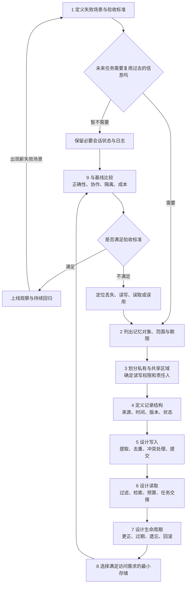

**Agent 记忆系统：主流方案比较与可复用设计流程**

调研日期：2026-10-22。依据官方文档、项目官方仓库和原始论文。这里选择的是有代表性的框架与记忆组件，不是市场份额排名；没有对它们运行统一性能基准。以下讨论应用层可读写的外部记忆，不涉及模型参数训练。框架事实与本文的工程建议分别标明。

核心设计问题是：**未来哪一次决策需要过去的什么信息？系统如何把这条信息可靠地送到有权限使用它的 Agent 面前？**

**一、先区分五个容易混淆的对象**

| 对象 | 回答的问题 | 例子 | 设计重点 |
|---|---|---|---|
| 当前上下文 | 这次模型调用能看见什么？ | 指令、最近对话、少量检索结果 | Token 预算与内容选择 |
| 会话状态与检查点 | 当前任务进行到哪里，重启后怎样继续？ | 任务计划、已完成工具调用、待处理事项 | 完整性、恢复、幂等 |
| 长期记忆 | 下次任务还需要知道什么？ | 用户偏好、项目决策、已验证经验 | 筛选、更新、检索与失效 |
| 多 Agent 共享状态 | 团队当前共同知道什么？ | 子任务状态、证据引用、产出版本 | 所有权、可见范围与并发一致性 |
| 外部知识库 | 有什么可引用的外部知识？ | 指南、产品文档、业务数据库 | 文档版本、权威来源与检索 |

这些对象可以共用存储设施，但业务语义不同。RAG 是一种检索后辅助生成的方式，也可以用于检索记忆；不能仅凭使用了向量检索，就把外部知识库与个人记忆当成同一个东西。微软官方也明确区分了对话存储、记忆提取与外部知识 RAG。[Microsoft Context provider integrations](https://learn.microsoft.com/en-us/agent-framework/integrations/by-component/context-providers/)

还要分开两个维度：**短期/长期描述使用范围与生命周期；内存/磁盘描述持久化方式。** 短期会话状态完全可以写入数据库；长期偏好也可以存成普通 JSON，不必使用向量库。

**二、代表性系统怎么设计，值得学什么**

| 框架或系统 | 官方设计要点 | 可以借鉴的设计思想 |
|---|---|---|
| LangGraph | 会话内的 State 通过 checkpointer 保存；跨会话信息放在带 namespace 的 Store 中。 | 把任务恢复与跨任务知识复用分开设计。[官方说明](https://docs.langchain.com/oss/python/concepts/memory) |
| CrewAI | 当前访问版本为 v1.15.28，采用统一 Memory；用 scope/slice 组织访问范围，召回综合语义、时间与重要性，支持只读视图。 | 多 Agent 可以共享底层存储，同时获得不同的读写视图。[官方说明](https://docs.crewai.com/v1.15.28/en/concepts/memory) |
| Google ADK | Session 管理 events/state，MemoryService 提供跨会话知识写入与搜索；不同实现可以保存原始会话，也可以抽取并整合信息。 | 先定义记忆接口，再选择实现；不能假设所有后端具有同样能力。[官方说明](https://adk.dev/sessions/memory/) |
| OpenAI Agents SDK | Session 维护会话历史；Sandbox memory 则提炼跨运行可复用的信息，按摘要、记忆文件、运行记录逐层读取。 | 对话连续性和经验复用分别处理，并按需展开细节。[Session 示例](https://developers.openai.com/cookbook/examples/agents_sdk/session_memory)、[Sandbox memory](https://developers.openai.com/api/docs/guides/agents/sandboxes#persist-memory-across-runs) |
| Microsoft Agent Framework | Context Provider 在调用前注入上下文、调用后提取或保存信息；多个 Provider 可以组合。 | 把记忆读取与写入放进统一生命周期，减少不同 Agent 各自拼装的差异。[官方说明](https://learn.microsoft.com/en-us/agent-framework/journey/adding-context-providers) |
| Letta | 当前 Agent SDK 使用 Git 支持的记忆文件；system/ 文件常驻上下文，其他文件按需读取；共享仓库通过提交、推送和拉取交换变更。 | 区分常驻核心信息与可检索细节；共享知识需要版本与同步机制。[Memory](https://docs.letta.com/agent-sdk/memory)、[Shared memory](https://docs.letta.com/concepts/shared-memory) |

AutoGen 的 AgentChat 还提供一个清晰的接口示例：`add`、`query`、`update_context`、`clear`、`close`，将存储、查询和注入模型上下文分开。这适合学习接口职责划分；本文没有据此断言其自带完整的长期记忆治理。[AutoGen Memory and RAG](https://microsoft.github.io/autogen/stable/user-guide/agentchat-user-guide/memory.html)

记忆组件应与 Agent 编排框架分别比较：

| 组件 | 重点能力 | 对设计的启发 |
|---|---|---|
| Mem0 | 从交互中抽取有用信息，并按用户等标识组织检索。当前 Add 文档明确描述为新增式写入，不自动覆盖或删除已有记忆。 | 接入服务之后，仍需明确更新、冲突和删除语义，不能套用旧版教程的行为假设。[官方说明](https://docs.mem0.ai/core-concepts/memory-operations/add) |
| Graphiti | 以事件为来源构建实体和关系，记录事实有效时间，并组合语义、关键词和图遍历检索。 | 当问题依赖“关系如何变化”“当时知道什么”时，时间与来源必须进入数据模型。[官方仓库](https://github.com/getzep/graphiti) |

这次调研中有两处明显的版本差异：CrewAI 当前文档已经由分立的短期、长期、实体记忆转为统一 API；Letta 当前文档建议从旧共享 memory blocks 迁移至共享仓库。学习时应提取职责和取舍，不能把旧类名当作长期稳定的架构规律。[CrewAI](https://docs.crewai.com/v1.15.28/en/concepts/memory)、[Letta](https://docs.letta.com/concepts/shared-memory)

**三、从这些实现中归纳出的共性**

下面是工程归纳，不代表每个框架都完整实现了这些能力。

1. **持久保存和送入模型分开。** 原始记录可以保留较多；每次调用只装配与任务有关的内容。
2. **记录事件和提炼知识分开。** “发生过什么”“现在认为事实是什么”“下次应该怎样做”是不同对象。
3. **写入需要判断。** 一句话是否值得记住、属于谁、依据是什么，通常比选择存储产品更早决定系统质量。
4. **共享需要契约。** 多 Agent 共用一个数据库，不代表它们会正确交换信息，也不代表它们应有同样权限。
5. **记忆需要被纠正。** 重复、过时、矛盾、删除和重试都应有明确处理规则。
6. **效果需要做对照。** 增加记忆后，应验证任务是否更准确，而不只是检索是否返回了结果。

经典的 Generative Agents 展示了从经历中形成反思、再检索用于后续行为的路径；LongMemEval 则提醒我们，评测还应覆盖跨会话推理、时间、知识更新与不知道时的弃答。两者提供设计和评测视角，并不能直接证明某个生产框架在你的业务上最好。[Generative Agents](https://arxiv.org/abs/2304.03442)、[LongMemEval](https://arxiv.org/abs/2410.10813)

**四、可以重复使用的九步设计流程**

**第 1 步：从失败场景定义收益。**

先写具体句子：“如果 Agent 忘记了 X，就会在 Y 任务中做错 Z。”例如，用户已经指定解释语言，下一次会话仍反复询问；研究 Agent 已经查过某份报告，诊断 Agent 却重新检索；用户更正了信息，旧值仍被用于回答。

同时写反例：“这类信息如果记住，反而会造成错误。”例如，把一次任务的临时要求变成所有任务的长期规则，或把模型的推测当成用户事实。

产出：一组验收场景，以及只保留必要会话状态、不增加跨会话记忆的基线。若未来没有明确复用场景，可以暂不引入长期记忆。

**第 2 步：决定记什么，保留多久。**

对每类候选信息标记三个维度：内容类型、复用范围、有效期限。事实、经历、做事规则可以作为内容分类；某条规则可能只适用于当前项目，不应自动成为全局规则。

| 候选信息 | 推荐对象 | 生命周期示例 |
|---|---|---|
| 当前正在做的子任务 | 任务状态 | 任务结束后归档或清理 |
| 已上传报告的位置 | 产物引用 | 跟随文件权限与保留策略 |
| 用户明确的解释偏好 | 用户事实 | 直到更正、撤回或过期 |
| 一次执行及其结果 | 事件/经历记录 | 用于追溯和后续案例检索 |
| 多次验证有效的工具使用方法 | 经验或流程规则 | 带适用条件和版本 |
| 外部医学指南 | 知识库文档 | 跟随来源和版本更新 |

产出：记忆对象清单。优先存可验证、可复用、会改变后续决策的信息；保留必要任务状态与证据，不要求保存模型隐藏的推理过程。

**第 3 步：决定谁能读、谁能写，怎样共享。**

使用稳定身份表达租户、用户、项目、会话、运行和 Agent；这些维度按需要组合，不必机械地全部放进同一层级路径。Agent 身份是“谁产生或使用信息”，用户身份是“信息属于谁”，两者不能替代。

对一个由协调器和多个 Worker 构成的系统，可以从以下权限矩阵出发：

| 信息区域 | Worker | 协调器/指定写入组件 |
|---|---|---|
| 本 Agent 的任务草稿 | 读写 | 按需读取 |
| 本任务已发布证据与结果 | 按权限读取，提交自己的结果 | 汇总、校验、发布新版本 |
| 用户的长期事实 | 按任务需要读取，提交候选变更 | 验证来源后写入 |
| 全局工作规则 | 读取已发布版本 | 通过版本发布流程更新 |

这只是适合当前项目的起点。对称协作系统也可以使用共享事件日志或多写者协议；需要显式定义合并规则。命名空间不是自动生效的安全边界，权限必须由服务或存储访问层检查，不能仅靠 Prompt 约束。

产出：权限矩阵、共享方式、写入责任人，以及子任务交接格式。

**第 4 步：定义一条记忆的数据结构。**

不要只定义一个 `text` 字段。以下是可裁剪的示意结构，不是某框架 API：

```json
{
  "memory_id": "mem-042",
  "tenant_id": "tenant-a",
  "subject_id": "user-a",
  "scope": {"kind": "user", "id": "user-a"},
  "kind": "preference",
  "key": "explanation_style",
  "value": "先解释专业术语，再给简短总结",
  "source_refs": ["session-7/message-12"],
  "source_kind": "user_statement",
  "assertion_status": "explicit",
  "writer_id": "memory-writer",
  "observed_at": "2026-10-22T10:00:00+08:00",
  "valid_from": "2026-10-22T10:00:00+08:00",
  "valid_to": null,
  "expires_at": null,
  "version": 1,
  "supersedes": null,
  "status": "active",
  "idempotency_key": "session-7/message-12/explanation_style"
}
```

其中，记录时间回答“系统什么时候知道”；有效时间回答“事实什么时候成立”；版本回答“哪次修改”；来源回答“为什么相信”。`explicit` 只表示用户明确表达，不等于外部事实已经验证。检索相似度也不等于事实可信度。

原始记录、抽取出的事实、模型提出的假设应保持可区分。模型推断可以保存为候选，并保留证据；不要自动变成已确认事实。

产出：Schema、字段含义、主键/幂等键、可查询字段和原始证据引用方式。

**第 5 步：设计写入与冲突处理。**

一条常用写入链路是：事件 → 候选提取 → 权限与来源检查 → 去重与冲突判断 → 提交版本 → 更新检索索引。这是本文建议的职责划分，可以由普通代码、服务或受限 Agent 实现，不必额外增加一个模型 Agent。

| 情况 | 推荐处理 |
|---|---|
| 重试送来同一个事件 | 使用幂等键，避免重复写入 |
| 内容相同且来源相同 | 去重；不要把重复引用当成多份独立证据 |
| 同一事实获得新的独立证据 | 追加来源，并保留证据状态 |
| 用户明确更正自己的偏好 | 发布新版本，并标记旧版本被替代 |
| 不同来源对事实描述冲突 | 保留来源和时间差异，标为待解决 |
| 事实随时间发生变化 | 关闭旧有效区间，新增有效区间 |
| Agent 的推断与已确认材料冲突 | 保存为假设或退回校验，不静默覆盖 |

即时更正和本轮后续任务必须依赖的信息，应先进入当前运行状态，必要时同步落库；较慢的经验提炼可以后台执行。后台写入要设计重试、失败记录和可见时点。下一步不能读取一个尚未完成的异步结果。

对共享写入，可以先由一个责任组件提交；允许多写者时，使用事务或版本检查。例如，两个 Worker 都基于 v3 修改同一字段，第一个提交 v4，第二个应重读并合并，不能无条件覆盖 v4。追加式证据集合可合并；对互相矛盾的事实，则需要领域规则或进一步核实。**最后写入并不自动意味着正确。**

产出：写入状态机、同步/异步边界、冲突策略和失败重试规则。

**第 6 步：设计读取与上下文装配。**

先写出未来的查询，再决定如何建立索引。例如，“这个用户偏好什么解释方式”适合按字段直接读取；“是否遇到过相似任务”适合语义召回；“上个月采用的是哪份材料”需要时间和版本条件。

推荐读取顺序：权限与范围限定 → 状态/时间过滤 → 精确查询或关键词/向量召回 → 重排与去重 → 按预算装配 → 保留来源引用。先做权限限定；如果后端不能在检索内限制范围，应保证未授权内容不会进入重排模型、生成上下文或相关日志。

上下文可以分为：必需的用户约束、当前任务状态、相关长期事实、必要的历史案例和证据引用。体积较大的原文通过引用按需打开。预算需要同时给当前输入、工具结果和模型输出留空间，而不是把检索条数当作唯一上限。

多 Agent 交接时，建议传一个明确的任务包：

```text
tenant/user/project/session/run 标识
任务目标和完成条件
当前仍有效的用户约束
已确认事实和证据引用
相关记忆 ID 与版本
已完成工作、未解决问题
允许读写的范围
本次读取所依据的状态版本
```

协调器读取过历史，不代表 Worker 已经获得历史。应检查每条调用路径的实际输入。长会话压缩还要保留工具调用与结果的关联、用户更正和未完成事项；压缩结果附原始消息引用，不能只截取前若干字符。

记忆内容应作为有来源的数据提供给模型。外部材料或历史记录中的命令，不应因被存入记忆就自动升级为系统规则。

产出：查询样例、检索链路、上下文预算和 Agent 交接契约。

**第 7 步：设计纠错、过期和遗忘。**

分别定义四件事：从当前上下文移除、检索时标为失效、归档历史、实际删除数据。它们不是同一个操作。

删除或更正应考虑原始记录、摘要、向量索引、缓存和衍生记忆；历史备份按已定义的保留策略处理，恢复时应重新应用删除标记，避免旧记录重新出现。对候选经验保留撤回和回滚路径；只有经过验证、具有适用条件的经验才进入可复用规则集。

同时检查：后台提取是否会重复处理旧事件；摘要是否继承了已失效事实；用户更正是否能覆盖所有读取路径；超过保存期限的数据是否仍能通过其他接口读到。以 Mem0 为例，当前文档中的过期条目默认从搜索隐藏，但按 ID 获取仍可返回，说明“过期”不能简单当成“删除”。[Mem0 expiration 语义](https://docs.mem0.ai/core-concepts/memory-operations/add)

产出：生命周期规则、清理任务、回滚方式和衍生数据失效策略。

**第 8 步：根据访问方式选存储。**

| 主要需求 | 可优先评估的实现 |
|---|---|
| 小规模本地验证、明确字段查询 | SQLite、结构化文件或现有数据库 |
| 事务、版本、权限、多用户并发 | 关系数据库与清晰的数据访问层 |
| 会话缓存与短期状态 | 内存或 Redis；是否持久化按恢复需求决定 |
| 语义相似检索 | 向量索引；可以附着于现有数据库 |
| 长原文、图片、报告 | 对象存储/文件系统，加元数据与权限引用 |
| 人与 Agent 共同维护经验 | Markdown/JSON 配合版本控制 |
| 复杂关系路径与时间关系查询 | 评估图模型；简单时态字段仍可用关系数据库 |

这些是按需求选择的工程建议，不是要求每层部署一套基础设施。起步时可以用一个数据库承担几类逻辑对象，再根据实际瓶颈拆分。图数据库只有在关系查询确实需要时才值得引入；时间字段本身并不要求图数据库。

产出：最小可用实现、容量与延迟预算，以及未来何时升级的条件。

**第 9 步：验证记忆改变了什么。**

固定模型、任务集与可比的资源预算，比较以下版本：仅必要会话状态、原始历史检索、经过筛选和更新的记忆。如果结构化记忆没有带来收益，应先定位提取、召回、装配或使用哪个环节失败。

| 测试场景 | 主要检查 |
|---|---|
| 隔几轮、隔一次重启再问 | 会话恢复和跨会话召回是否符合设计 |
| 用户纠正旧信息后再问 | 是否使用新值；是否能说明更正来源 |
| 问“当时”的情况 | 是否错误使用现在的事实回答过去的问题 |
| 系统从未得到过所问信息 | 是否承认不知道而非补造记忆 |
| 多 Agent 接力 | Worker 是否收到必要事实、约束和版本 |
| 两个 Agent 同时更新 | 是否丢失变更；冲突是否可追溯 |
| 两个用户问相似问题 | 是否发生跨用户信息泄漏 |
| 删除或失效后再检索 | 缓存、摘要和索引是否仍返回旧数据 |
| 重复事件、写入失败、索引延迟 | 是否重复记录、静默丢失或读取旧版本 |

LongMemEval 的信息提取、跨会话推理、时间推理、知识更新和弃答能力可以作为记忆评测的参考；多 Agent 的权限、并发与交接测试需要另行增加。[LongMemEval](https://arxiv.org/abs/2410.10813)

除了任务成功率，还应观察必要事实召回率、错误记忆引用率、过期事实使用率、写入重复率、每次调用的 Token/延迟/成本。指标阈值由业务决定，不预设通用合格数字。每次调用记录使用了哪些 memory ID、版本、来源和排序理由，才能定位问题。

产出：可重复的回归集、对照结果和上线监测指标。

**五、把流程套到当前医疗助手项目**

这里只演示设计推导，不修改应用实现，也不提供医学判断。

建议先使用四类逻辑对象：会话记录与当前任务状态、单次 Swarm 的共享任务板、用户事实与偏好、带来源和结果状态的历史经历。医学指南继续作为独立知识来源；历史模型回答保存为“某次回答”，不能自动升级为已验证医学事实。

| 当前代码中可见的情况 | 对应的设计问题 | 优先处理方向 |
|---|---|---|
| 长期记忆读写使用固定 `medix_user` | 记忆属于谁？ | 让用户身份贯穿接口、存储和检索过滤。[代码](../medix-agent-swarm/memory/long_term.py) |
| 把问题与截取的回答合并为一条 user 消息交给 Mem0 | 信息来源是什么？ | 保留真实角色、证据引用和断言状态，区分用户陈述与模型生成。[代码](../medix-agent-swarm/memory/long_term.py) |
| 协调器检索历史，但 Swarm 创建的新 SharedContext 未直接承接这份增强上下文；默认子任务输入也未传 session_id/context | Worker 实际看见什么？ | 定义统一任务包，并验证单 Agent 与 Swarm 两条路径。[协调器](../medix-agent-swarm/swarm/swarm_coordinator.py)、[子任务入口](../medix-agent-swarm/agents/base_agent.py) |
| SharedContext 承担一次运行中的协作数据 | 当前协作与跨会话积累怎样衔接？ | 运行中发布结构化证据；任务结束后有选择地形成长期记录。[代码](../medix-agent-swarm/swarm/shared_context.py) |

一个具体例子：用户先说“请简短回答”，后又说“这个问题先解释术语”。需要先判断后一句的作用域：是本题要求，还是长期偏好更改。本题要求进入任务包；明确的长期偏好更改才形成新版本。研究 Agent 得到的文档引用进入共享任务板；最终回答进入会话记录；经结果验证的工具经验才成为下次可复用的经验。

因此，对这个项目的优先顺序建议是：先使身份、来源与上下文传递一致，再做好更新、删除和回归测试，之后再评估复杂的图记忆或自动经验提炼。

**六、设计流程图**



配套空白设计卡：[agent-memory-design-template.md](agent-memory-design-template.md)。按顺序填写，再画出自己的读写链路；遇到答不清的问题，先用一个具体业务场景验证。
